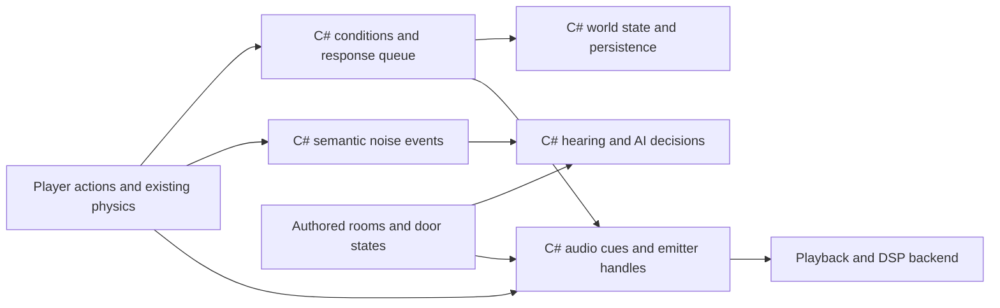

# Engine Systems Research For The Updated Game Direction

Researched: 4 November 2026. Status: source/documentation review and proposed work. No runtime implementation, engine installation, imported game assets or external-engine benchmarks are included.

Execution order clarified: **finish and accept the current lighting implementation before starting any new engine system upgrade or prototype.** The [prioritised upgrade plan](ENGINE_SYSTEM_UPGRADE_PLAN.md) is the implementation sequence and also retains the current baseline stability gate. This research does not clear either prerequisite.

## Recommendation

Use **O3DE** as the large-engine reference closest to the user's Lumberyard example; **ezEngine** for content authoring and surface responses; **The Dark Mod** and **Arx Libertatis** for immersive-sim interactions; and **Godot** for a readable audio architecture. **OpenMW** adds useful examples of AI movement, inventory and persistence. Include **CRYENGINE** as a documentation and architecture reference, with its source-access and license limits stated explicitly. Treat archived Lumberyard as historical context.

Keep the existing C# engine. Recreate suitable patterns in its entities, scripts and editor data, then evaluate small native libraries where useful. A sophisticated external engine is evidence of available techniques, not evidence that transplanting its architecture will improve this project's frame times.

The creative target is recorded in [Game Style Objective](GAME_STYLE_OBJECTIVE.md). This research excludes new lighting, reflections, visual atmosphere and horror rendering, as requested. Sound remains in scope, including room acoustics. Existing physics supplies interactions and events; replacing its solver is outside this proposal.

## What The Project Already Has

The following are observations from this checkout, rather than assumptions about a generic engine:

| Existing foundation | Relevant local source | Implication |
| --- | --- | --- |
| C# entities with stable IDs, components and registered script factories | [Entity.cs](../Engine.Runtime/Entities/Entity.cs), [ScriptRegistry.cs](../Engine.Runtime/Entities/ScriptRegistry.cs) | Add focused services and components around these structures. A new ECS or scripting language is unnecessary for this work. |
| Inventory requirements, target links, rewards, persistent puzzle states and pressure plates | [LevelTypes.cs](../Engine.Editor/Editor/LevelTypes.cs), [HL2GameModule.cs](HL2GameModule.cs), [puzzle implementation](HL2GameModule.Puzzles.cs) | Extend the current interaction vocabulary. `RequiredStates` currently checks all supplied requirements; alternative branches need an explicit representation. |
| Prefab instances, source IDs, editor apply/revert and reference remapping | [PrefabIO.cs](../Engine.Editor/Editor/PrefabIO.cs), [level definitions](../Engine.Editor/Editor/LevelTypes.cs) | Start with reusable architectural and machine kits. Audit gaps before implementing features another engine already names. |
| Room and portal definitions | [RoomVisibility.cs](../Engine.Editor/Editor/RoomVisibility.cs) | Reuse stable room/portal identifiers for additional authored data. The current graph is explicitly camera visibility only; it cannot decide hearing or navigation. |
| Existing custom C# physics and HL2-style manipulation | [physics implementation notes](../Engine.Physics/README.md), [game implementation notes](README.md) | Observe impacts, surfaces and mass changes without changing solver behavior. A box can become a sound source and distraction as well as a puzzle weight. |
| Native C ABI already used for RmlUi | [bridge contract](../Native/HS2RmlUiBridge/README.md) | There is a local precedent for keeping C# ownership while wrapping a focused native subsystem. This does not make audio integration automatic. |
| Audio authoring workflow documented; runtime spatial audio remains a future milestone | [AUDIO_WORKFLOW.md](AUDIO_WORKFLOW.md) | Waveform, Surge XT, Audacity and jsfxr author assets. Playback, mixing, spatialization and gameplay hearing still require runtime systems. |

The current [frame-pacing investigation](FRAME_PACING_GUIDE.md) remains open. Normal play uses the documented full-detail path. New work must keep its own timings and preserve the existing acceptance references.

## Engine Comparison And Access

All engine entries below have C++ source. Their availability and reuse terms differ.

| Engine | Current access / code license | Best fit for this project | Main limitation |
| --- | --- | --- | --- |
| [O3DE](https://github.com/o3de/o3de) | Public; Apache-2.0 or MIT option in its [license](https://github.com/o3de/o3de/blob/development/LICENSE.txt) | Audio abstraction, worker requests/callbacks, asset processing, nested prefab updates | Large framework and build system; middleware and third-party dependencies have their own terms. |
| [CRYENGINE](https://www.cryengine.com/) | Source-available under Crytek's agreement; 5.7 LTS source requires requested access | Audio triggers/parameters/environments, AI perception and spatial query design | Not a permissive open-source engine or an unrestricted source donor for a separate engine. Current private source was not inspected. |
| [Amazon Lumberyard](https://github.com/aws/lumberyard) | Archived source under Lumberyard terms | Historical audio-thread and abstraction design; understanding O3DE's lineage | No longer offered; custom license, not O3DE's Apache/MIT license. |
| [ezEngine](https://github.com/ezEngine/ezEngine) | Public; MIT | Surface interaction assets, prefab parameters, content dependencies and editor workflow | Its FMOD integration does not make FMOD itself MIT-licensed. |
| [Godot](https://github.com/godotengine/godot) | Public; MIT; C++ core with C# integration | Audio buses, effects, positional emitters, attenuation and variation resources | These audio systems alone do not provide a complete room/door acoustic propagation model. |
| [The Dark Mod](https://www.thedarkmod.com/download-sourcecode/) | Public SVN and mirrored code; GPLv3-or-later with additional notices | Stimulus/response, hearing propagation, investigation behavior and mapper-facing rules | Strongly integrated with its engine. Media have different licenses, including noncommercial terms. |
| [Arx Libertatis](https://github.com/arx/ArxLibertatis) | Public; GPLv3-or-later, notices in README/COPYING/LICENSE | Item/script events and material-pair impact sounds connected to hearing | A game-specific source port, not a modern general-purpose content editor; original game data is separate. |
| [OpenMW](https://github.com/OpenMW/openmw) | Public; GPLv3 | AI movement packages, world/item references, inventory state and sound lifecycle | Morrowind-specific compatibility adds complexity; playing Morrowind requires its separately owned game data. |

License sources: [Godot](https://github.com/godotengine/godot/blob/master/LICENSE.txt), [ezEngine](https://github.com/ezEngine/ezEngine/blob/dev/LICENSE.md), [The Dark Mod](https://svn.thedarkmod.com/publicsvn/darkmod_src/trunk/LICENSE.txt), [Arx](https://github.com/arx/ArxLibertatis/blob/master/COPYING), [OpenMW](https://github.com/OpenMW/openmw/blob/master/README.md), [Lumberyard](https://github.com/aws/lumberyard/blob/master/LICENSE.txt).

**CRYENGINE clarification:** Crytek currently states a 5% royalty with the first USD 5,000 of annual revenue per project exempt. Its agreement restricts combining engine code with other engine providers' code and distributing it as a standalone development engine. Use the documented concepts as research; do not treat source access as permission to extract a subsystem into this engine. The 5.7 access page is more specific than older documentation describing unrestricted public GitHub access. Sources: [licensing](https://www.cryengine.com/support/view/licensing), [agreement](https://www.cryengine.com/ce-terms), [5.7 source access](https://www.cryengine.com/docs/static/engines/cryengine-5/categories/23756813/pages/89457345).

**Lumberyard clarification:** AWS says Lumberyard is no longer offered and directs developers to O3DE, its official successor. Its archived source is still useful to read, but O3DE is the better current starting point. [AWS status](https://docs.aws.amazon.com/lumberyard/).

GPL code can be used under its license, including commercially; it is not a permissive drop-in dependency for any distribution model. For this plan, study its behaviors and independently implement appropriate C# systems. Translating code to C# does not remove its license obligations. Engine code licenses also do not grant rights to the referenced games' models, textures, music or sounds.

## Source Reading Routes

### 1. O3DE: audio boundaries and content workflow

Read these together:

- [AudioSystem.h](https://github.com/o3de/o3de/blob/19c096e51f638d7be9e231d551ca3f688af34bf2/Gems/AudioSystem/Code/Source/Engine/AudioSystem.h) and [AudioSystem.cpp](https://github.com/o3de/o3de/blob/19c096e51f638d7be9e231d551ca3f688af34bf2/Gems/AudioSystem/Code/Source/Engine/AudioSystem.cpp).
- [ATL.h](https://github.com/o3de/o3de/blob/19c096e51f638d7be9e231d551ca3f688af34bf2/Gems/AudioSystem/Code/Source/Engine/ATL.h).
- [PrefabSystemComponent.cpp](https://github.com/o3de/o3de/blob/19c096e51f638d7be9e231d551ca3f688af34bf2/Code/Framework/AzToolsFramework/AzToolsFramework/Prefab/PrefabSystemComponent.cpp).
- [Asset processor manager declarations](https://github.com/o3de/o3de/blob/19c096e51f638d7be9e231d551ca3f688af34bf2/Code/Tools/AssetProcessor/native/AssetManager/assetProcessorManager.h).

**Observed:** `CAudioSystem` owns an audio thread and separate request/callback queues. `PushRequest` and `PushRequests` enqueue work; `ExternalUpdate` handles callbacks on the main thread. A separate blocking path explicitly waits. ATL exposes named trigger, parameter and switch controls. Prefab changes propagate through queued instance updates.

**Adaptation:** gameplay submits cue IDs, emitter handles and parameter changes to a C# audio service. Backend completion returns through a controlled queue; it does not mutate gameplay from an audio callback. Make blocking loads an explicit loading operation. Extend the existing content pipeline with dependency/version metadata and actionable import errors where missing. Adopt small prefab parameters such as sign text, material choice, machine state and sound profile before adding more override complexity.

**Limit:** this is an architectural reference, not a proposal to embed O3DE, its buses or its editor. The official [audio overview](https://www.docs.o3de.org/docs/user-guide/interactivity/audio/overview/) also distinguishes the engine abstraction from Wwise implementation modules; the middleware has separate terms.

### 2. CRYENGINE and Lumberyard: production system contracts

CRYENGINE's public [audio documentation](https://www.cryengine.com/docs/static/engines/cryengine-5/categories/23756813/pages/26871538) describes `CryAudio::IAudioSystem`, entity audio components, triggers, parameters, switches and environments. Its [UQS documentation](https://www.cryengine.com/docs/static/engines/cryengine-5/categories/23756816/pages/29450474) describes generating, filtering and ranking spatial candidates. Its [AI overview](https://www.cryengine.com/docs/static/engines/cryengine-5/categories/23756816/pages/25534272) separates perception, behavior and navigation. UQS's linked documentation labels the feature beta; this is a design reading route, not a production endorsement.

**Adaptation:** separate observing the world from deciding what to do. A future guard can gather reachable investigation positions, reject blocked ones, then score remaining candidates for distance and relevance. Start with a handful of points and a bounded query budget. Audio cues should expose meaningful controls such as machine load or player exertion instead of scattering filenames and volume adjustments across scripts.

The archived [Lumberyard AudioSystem.h](https://github.com/aws/lumberyard/blob/413ecaf24d7a534801cac64f50272fe3191d278f/dev/Gems/AudioSystem/Code/Source/Engine/AudioSystem.h) provides an inspectable historical example of an audio thread and thread-safe requests. Compare its older queues with O3DE's current version. Do not infer that this grants rights to current CRYENGINE code, or that the two implementations are interchangeable.

### 3. ezEngine: surfaces connect art, physics and sound

- [SurfaceResource.cpp](https://github.com/ezEngine/ezEngine/blob/59ca5986e0cf07d94fc360e426e102a60ca60d81/Code/Engine/Core/Physics/Implementation/SurfaceResource.cpp), especially `FindInteraction` and `InteractWithSurface`.
- [PrefabReferenceComponent.cpp](https://github.com/ezEngine/ezEngine/blob/59ca5986e0cf07d94fc360e426e102a60ca60d81/Code/Engine/Core/Prefabs/Implementation/PrefabReferenceComponent.cpp), especially exposed parameter serialization and instantiation.
- [AssetCurator.h](https://github.com/ezEngine/ezEngine/blob/59ca5986e0cf07d94fc360e426e102a60ca60d81/Code/Editor/EditorFramework/Assets/AssetCurator.h), for dependency hashes, transform states and missing-dependency reporting.

**Observed:** surface interactions are looked up by type, support base-surface fallback, and use impulse thresholds to choose a response. An interaction can instantiate a prefab with contextual parameters. Appearance and behavioral surface are separate concepts. See its [surface documentation](https://ezengine.net/pages/docs/materials/surfaces.html).

**Adaptation:** define a small `SurfaceProfile` vocabulary: metal, glass, wood, stone, fabric and water where the game needs them. Many visual materials can refer to one profile. Pair a surface and interaction type to a cue/effect response: footstep, bullet hit, bump, scrape or break. Read existing results through game-side adapters where available; apply thresholds and cooldowns so resting contacts do not repeatedly fire sounds. Preserve current mass, friction, restitution and the physics implementation. Defer feedback that requires new solver/contact APIs.

For the BioShock art objective, the useful lesson is authoring consistency: architectural kits, reusable machinery and controllable variants. Shared trim and material conventions, original signage, ornament and damage placement create the visual language. An engine supplies the tools; an MIT renderer does not supply BioShock art direction.

### 4. The Dark Mod: systemic reactions and gameplay hearing

Official source: [SVN](https://svn.thedarkmod.com/publicsvn/darkmod_src/trunk/). The source-reading links below use a pinned GitHub mirror revision:

- [Response.cpp](https://github.com/stgatilov/darkmod_src/blob/c1ab71003d544dbedcbcfce7d2bfc4af7cf7a650/game/StimResponse/Response.cpp), especially `CResponse::TriggerResponse`.
- [SndProp.h](https://github.com/stgatilov/darkmod_src/blob/c1ab71003d544dbedcbcfce7d2bfc4af7cf7a650/game/SndProp.h) and [SndProp.cpp](https://github.com/stgatilov/darkmod_src/blob/c1ab71003d544dbedcbcfce7d2bfc4af7cf7a650/game/SndProp.cpp), especially `CsndProp::Propagate` and portal event data.

**Observed:** responses receive a source and stimulus, notify their owning entity and can run a configured action. Hearing propagation has its own spatial/portal information and persistence. The mapper documentation distinguishes AI sound propagation from player playback and permits separate portal losses for each. [Portal sound loss](https://wiki.thedarkmod.com/index.php?title=Sound_Propagation%3A_Part_1).

**Adaptation:** introduce typed stimuli and a bounded C# response queue. Begin with noise, impact, use and state changes. Add heat/electricity only when actual gameplay needs them. Each response defines its conditions, range or target, cooldown and resulting action. Record a cause ID and enforce a reaction budget to diagnose and stop accidental cycles.

Keep `NoiseEvent` separate from the audible voice. Muting sound, reducing audio quality, or virtualizing a distant voice must not change whether a guard hears the thrown crate. Author an acoustic graph using room/portal IDs and door state, with separate tuning for gameplay hearing and player acoustics. Camera visibility must not suppress an off-screen guard's hearing.

### 5. Arx Libertatis: physical feedback that participates in gameplay

- [GameSound.cpp](https://github.com/arx/ArxLibertatis/blob/5b95e4c5ca9d583f1b11c085326979772645e0f3/src/scene/GameSound.cpp), especially `ARX_SOUND_PlayCollision` and collision map creation.
- [ScriptEvent.cpp](https://github.com/arx/ArxLibertatis/blob/5b95e4c5ca9d583f1b11c085326979772645e0f3/src/script/ScriptEvent.cpp), especially event registration and dispatch.

**Observed:** material-pair collision handling selects a sample, sets spatial falloff, varies pitch and can call `spawnAudibleSound` for hearing. This provides a concrete example of an impact connecting physical materials, audible feedback and a gameplay signal.

**Adaptation:** one accepted impact produces both a presentation request and a semantic noise event. Keep their tuning distinct. A metal object dropped on tile should communicate its material and strength, while the AI receives an authored salience value. Normalize scale carefully and keep physical impulse units distinct from audio gain or hearing loudness. Cache cue handles and use reusable buffers on frequent paths.

**Limit:** Arx's collision function includes audio-initialization and camera-distance early-outs before its hearing call. Study the coupling, but do not reproduce those early-outs for gameplay hearing in this engine. Audio device availability and listener distance must not determine simulation outcomes.

### 6. Godot: readable runtime audio and variation

- [AudioStreamPlayer3D](https://github.com/godotengine/godot/blob/fefec82d74b46f5e6cc31f373071058f80a5cbee/scene/3d/audio_stream_player_3d.cpp): attenuation, listener-relative panning and area reverb routing.
- [AudioServer](https://github.com/godotengine/godot/blob/fefec82d74b46f5e6cc31f373071058f80a5cbee/servers/audio/audio_server.cpp): bus mixing and effect processing.
- [AudioStreamRandomizer](https://github.com/godotengine/godot/blob/fefec82d74b46f5e6cc31f373071058f80a5cbee/scene/resources/audio/audio_stream_randomizer.cpp): weighted choices, no-repeat selection and pitch/volume variation.
- [Mono module](https://github.com/godotengine/godot/blob/fefec82d74b46f5e6cc31f373071058f80a5cbee/modules/mono/README.md): a native engine exposing managed functionality.

**Adaptation:** keep sound cues as assets: weighted variants, repeat prevention, pitch/gain ranges, bus, spatial settings, priority and concurrency limits. Route dialogue, player actions, world effects, ambience, music and UI through adjustable buses. Use short, controlled variation to make repeated footsteps and impacts convincing. Build an editor audition panel before tuning sounds only by recompiling code.

**Limit:** distance attenuation, area reverb and stereo panning are separate from obstruction, transmission and binaural filtering. Do not label basic panning as HRTF or claim that a reverb zone alone models sound around a closed door.

### 7. OpenMW: behavior, movement and persistent item state

- [AiPackage::pathTo and door handling](https://github.com/OpenMW/openmw/blob/9666b295d1a4bd46e7a8aed5e305bffc0366734c/apps/openmw/mwmechanics/aipackage.cpp).
- [ContainerStore state writing/reading](https://github.com/OpenMW/openmw/blob/9666b295d1a4bd46e7a8aed5e305bffc0366734c/apps/openmw/mwworld/containerstore.cpp).
- [SoundManager](https://github.com/OpenMW/openmw/blob/9666b295d1a4bd46e7a8aed5e305bffc0366734c/apps/openmw/mwsound/soundmanagerimp.cpp).

**Observed:** AI movement handles route updates, obstacles and doors. Inventory persistence restores typed item records and instance state. The sound manager differentiates attached positional sounds, streamed audio and stopping/fading voices.

**Adaptation:** separate an AI's current intent from navigation and animation. Begin with patrol, investigate, search and return states, carrying a remembered position and confidence. Save stable entity references and relevant item/machine state, then rebuild transient native handles after load. Stop attached loops when their owning entity is destroyed or a level unloads. Do not implement Morrowind's entire actor/inventory compatibility model.

## Focused Libraries Worth Evaluating

These are supporting libraries, not replacement game engines.

| Library | Source and license | Proposed role | Evaluation limit |
| --- | --- | --- | --- |
| Steam Audio | [C API](https://github.com/ValveSoftware/steam-audio/blob/480dd64f513cc8a6437e7d5b9eb0d3f1d30c2fac/core/src/core/phonon.h), [direct simulator](https://github.com/ValveSoftware/steam-audio/blob/480dd64f513cc8a6437e7d5b9eb0d3f1d30c2fac/core/src/core/direct_simulator.cpp), [Apache-2.0](https://github.com/ValveSoftware/steam-audio/blob/master/LICENSE.md) | Later HRTF, obstruction/transmission and acoustic simulation behind a native boundary | Supply scene geometry/materials and a PCM processing path. It is not a complete sound-event, music, asset-streaming or AI-hearing system. Budget simulation independently from mixing. |
| SoLoud | [bus implementation](https://github.com/jarikomppa/soloud/blob/e82fd32c1f62183922f08c14c814a02b58db1873/src/core/soloud_bus.cpp), [C# wrapper generator](https://github.com/jarikomppa/soloud/blob/e82fd32c1f62183922f08c14c814a02b58db1873/scripts/gen_cs.py), [zlib/libpng license](https://github.com/jarikomppa/soloud/blob/master/LICENSE) | Candidate first playback/mixing backend: voices, buses, filters and basic positional playback | Check .NET 10, x64 packaging, device changes, streaming and disposal. Generated bindings are a starting point, not proof of a maintained NuGet integration. Steam Audio would require a deliberate DSP integration. |
| Recast/Detour | [modules and examples](https://github.com/recastnavigation/recastnavigation/blob/9f4ce64458dfae86e1239c525ddc219c4e9e06f1/README.md), [query implementation](https://github.com/recastnavigation/recastnavigation/blob/9f4ce64458dfae86e1239c525ddc219c4e9e06f1/Detour/Source/DetourNavMeshQuery.cpp), [zlib license](https://github.com/recastnavigation/recastnavigation/blob/main/License.txt) | Bake navigation; run bounded path queries for future NPCs | Door permissions, agent dimensions, dynamic obstructions and off-mesh actions need game integration. It does not provide perception or a physics solver. |
| ink | [C# runtime](https://github.com/inkle/ink/blob/35c63e52f1d36060930dc7ed3cfba38ea224b528/ink-engine-runtime/Story.cs), [MIT](https://github.com/inkle/ink/blob/master/LICENSE.txt) | Optional later branching conversations, readable logs and story consequences using managed code | Only add it when branching narrative warrants it. Ordinary pickups, subtitles or a linear audio log do not require a narrative language. |

Recommended first audio experiment: evaluate SoLoud through `IAudioService` with representative original sounds. Keep Steam Audio as a separately measured second experiment. Choose a backend only after an in-engine prototype verifies its lifetime, threading and output behavior. Existing Waveform/Surge/Audacity/jsfxr workflows remain the authoring starting point; assets from the other game are not automatically reused.

## C# Runtime Structure

The proposed ownership is:



Use typed IDs and validated definitions rather than placing every new feature in `HL2GameModule.cs`. Illustrative API sketch only; these types are not implemented:

```csharp
public readonly record struct SoundCueId(int Value);
public readonly record struct VoiceHandle(int Index, int Generation);

// Produced by gameplay, independent of output volume or a playing voice.
public readonly record struct NoiseEvent(
    string SourceEntityId, Vector3 Position,
    float Salience, string Category, long SimulationTick);

public interface IAudioService
{
    VoiceHandle Play(SoundCueId cue, Vector3 position);
    void SetPosition(VoiceHandle voice, Vector3 position);
    void SetParameter(VoiceHandle voice, int parameterId, float value);
    void Stop(VoiceHandle voice, float fadeSeconds);
}

// For an accepted impact, after thresholds and cooldowns:
// 1. Resolve surfaces + interaction into a response definition.
// 2. Publish its NoiseEvent to gameplay hearing.
// 3. Submit its optional cue to IAudioService.
// Audio output failure or voice stealing must not cancel step 2.
```

Keep backend pointers private and validate generation-based handles. Batch commands where useful. Do not call the physics world, allocate asset data, decode files or execute managed gameplay on a real-time audio callback. Acoustic simulation can run at a separately budgeted frequency and publish immutable results. Persist authored cue/state references and loop intent; rebuild playback handles on load rather than serializing native memory or replaying one-shot sounds.

For rules, add explicit `All`/`Any` conditions and typed actions incrementally. Map existing `RequiredStates` to `All` so old levels keep their meaning. Commit item consumption and state changes together only after conditions succeed. Retain a thin adapter for existing interaction kinds while extracting shared behavior into C# services.

## Art And Sound Direction In Engine Terms

For BioShock-inspired art direction, prioritize authoring features: a modular architectural kit, controlled visual variants, signage/story-prop prefabs and validated asset references. A proposed room art profile can document proportions, materials, trim conventions, sign style and prop categories without becoming a procedural room generator. Add decals or material-variant tools only after auditing the current editor and proving a content need. These features use the existing rendering path; no lighting redesign is proposed here.

The sound interpretations below are recommendations for this game's target, not claims about proprietary engine implementations:

| Influence | Translate into authored behavior |
| --- | --- |
| Dead Space remake | Mechanical identity per area, layers responding to machine/player state, carefully placed distant sources and spatial transitions. |
| Half-Life 2 | Distinctive footsteps, impacts, handling sounds and machinery that explain how the physical world responds. |
| Doom Eternal | Strong attack/impact/transient definition and rhythmic intensity changes that keep important actions readable. |
| The Last of Us Part II | Detailed movement and material sounds, controlled dynamic range and clear dialogue/threat information amid dense scenes. |

Provide mix controls, subtitles/captions for important cues, and readable state feedback. Musical intensity is presentation state; it must not silently change enemy knowledge. No proprietary audio code or game recordings are required for these targets.

## Proposed Development Sequence

Use the [Prioritised Engine Systems Upgrade Plan](ENGINE_SYSTEM_UPGRADE_PLAN.md) for the current order, detailed deliverables, source-reading routes and acceptance checks. **Lighting completion and acceptance come before any new-system implementation, including preparatory refactors or prototypes.** The existing baseline stability gate also remains required.

After both gates clear, proceed through minimal C# contracts, runtime audio, surface feedback, composable interactions, focused art/prefab authoring, room acoustics, one investigating NPC and the combined playable slice. Persist and validate each system as it is introduced. Preserve the physics implementation and accepted lighting throughout those phases; derive new performance budgets from the accepted baseline.

## First Playable Research Test

Build a small original service foyer and machine room. Use the existing six-room scene as a regression reference; keep this new experiment separately authored.

The obstacle is a service door. Proposed solutions are an appropriate inventory item, restoring its machine state, or moving a physical load onto a mass sensor that operates a bypass. These are future alternative branches, not a claim that the current conjunctive puzzle gate already supports them. Give the approaches meaningful differences in noise, resource use or exposure.

A metal prop can supply weight, block a doorway where supported, or create a noisy distraction when thrown. One NPC investigates a remembered sound location. Opening a connecting door changes acoustic transmission; camera turns do not change hearing. Signage, machine sounds and original props explain what the place was for and which systems are operating.

Verify that all solutions remain understandable, saves restore the changed world, muted playback leaves hearing behavior unchanged, and moving the prop does not strand progression. This applies the earlier [orthogonal-design research](ORTHOGONAL_GAME_DESIGN_RESEARCH.md): a few dependable capabilities create several meaningful situations.

## Source Snapshots And Limits

Pinned source links above refer to these branch-head revisions retrieved on 4 November 2026. Where a repository is a mirror, this identifies the reviewed mirror snapshot, not a claim about an upstream release.

| Repository | Branch | Revision |
| --- | --- | --- |
| o3de/o3de | development | `19c096e51f638d7be9e231d551ca3f688af34bf2` |
| aws/lumberyard | master, archived | `413ecaf24d7a534801cac64f50272fe3191d278f` |
| ezEngine/ezEngine | dev | `59ca5986e0cf07d94fc360e426e102a60ca60d81` |
| godotengine/godot | master | `fefec82d74b46f5e6cc31f373071058f80a5cbee` |
| stgatilov/darkmod_src | trunk mirror | `c1ab71003d544dbedcbcfce7d2bfc4af7cf7a650` |
| arx/ArxLibertatis | master | `5b95e4c5ca9d583f1b11c085326979772645e0f3` |
| OpenMW/openmw | master mirror | `9666b295d1a4bd46e7a8aed5e305bffc0366734c` |
| ValveSoftware/steam-audio | master | `480dd64f513cc8a6437e7d5b9eb0d3f1d30c2fac` |
| jarikomppa/soloud | master | `e82fd32c1f62183922f08c14c814a02b58db1873` |
| recastnavigation/recastnavigation | main | `9f4ce64458dfae86e1239c525ddc219c4e9e06f1` |
| inkle/ink | master | `35c63e52f1d36060930dc7ed3cfba38ea224b528` |

CRYENGINE was reviewed through current official public documentation and terms, not private 5.7 source. The older [engine rendering research](OPEN_SOURCE_ENGINE_RESEARCH.md) remains a dated reference for its original scope. No claim here establishes that an external engine is faster than this project or that the proposed systems have been integrated.
